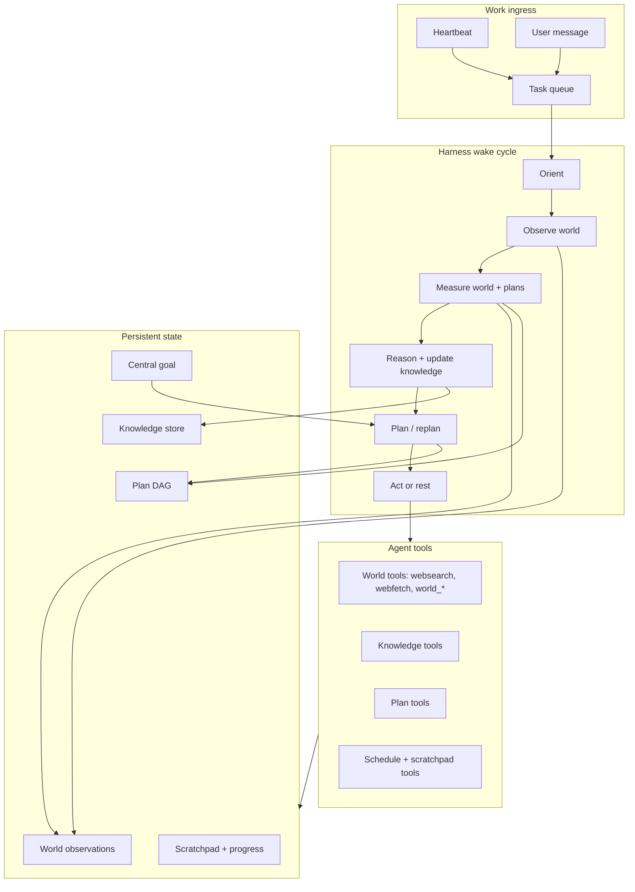
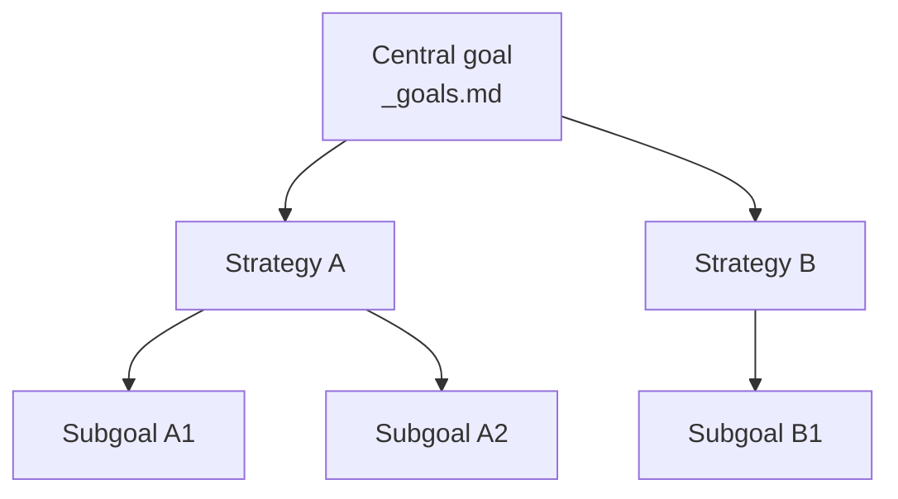
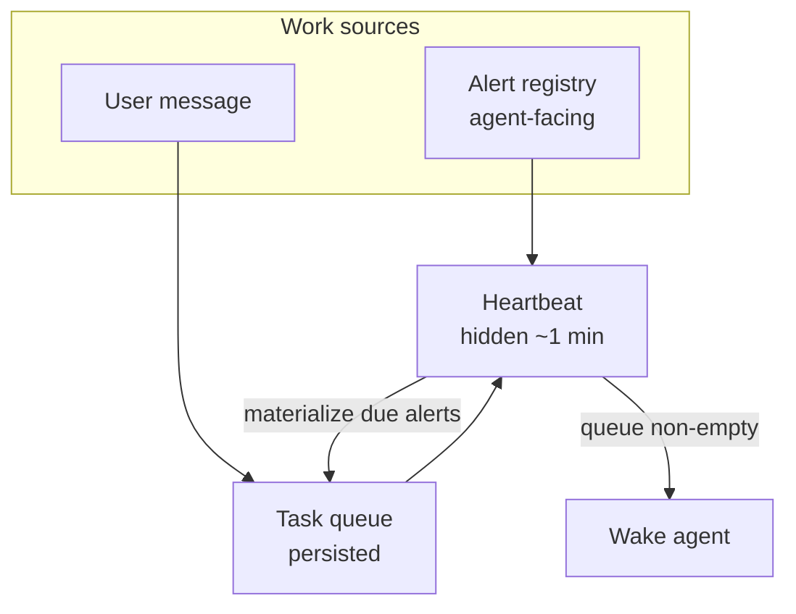
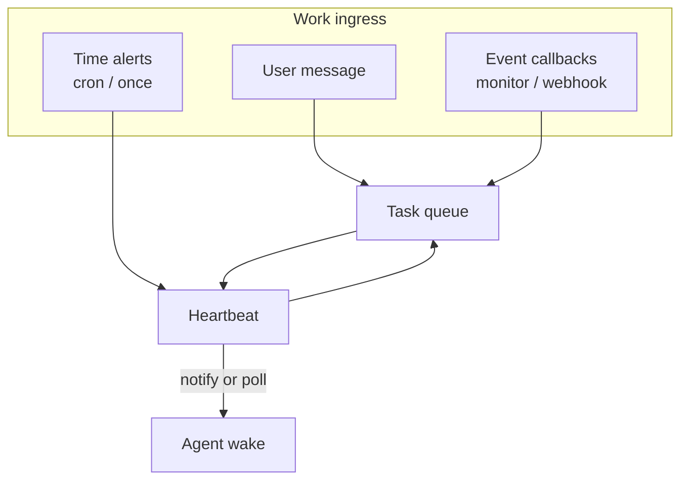
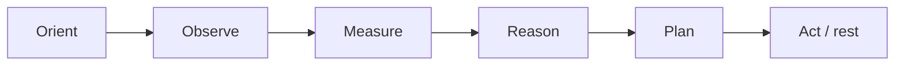
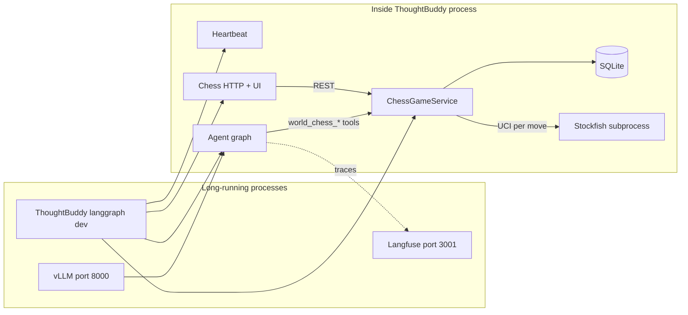
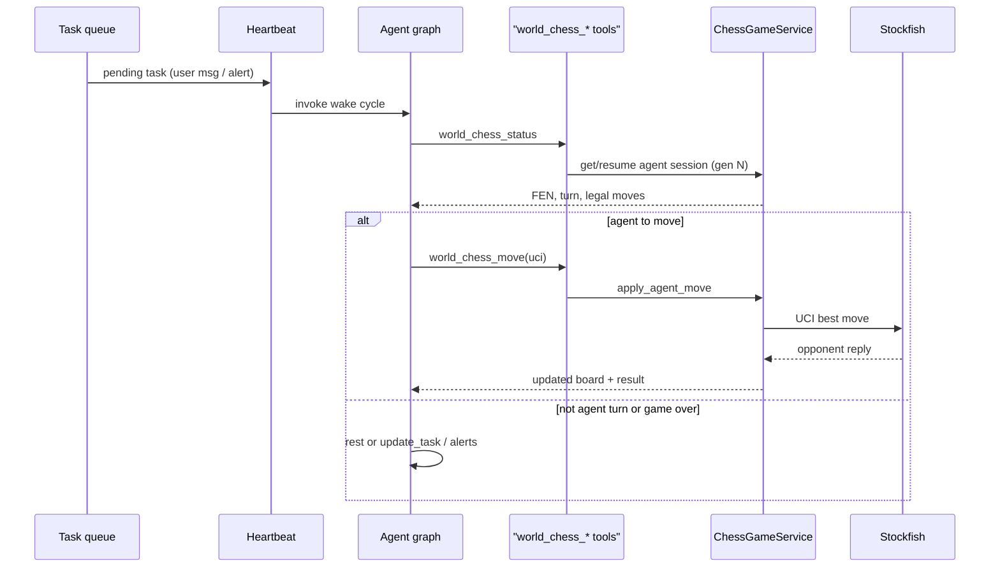

# ThoughtBuddy — Agent Instructions

Living master plan + architecture reference. Update this file when direction, layout, or progress changes.

---

## Objective

Build a **stateful agent harness** on a loop (fixed order each wake):

**orient → observe → measure → reason → plan → act/rest**

The agent operates in a constructed virtual world toward a **single central goal**. It maintains durable state across wake cycles in three **pillars** plus agent-owned scratch files:

| Concern | What it is | Design constraint |
|---|---|---|
| **World** | External + virtual environment (GM truth when an experiment provides it) | Observed via `websearch`/`webfetch` **or** domain-specific virtual-world tools |
| **Knowledge** | Accumulated facts, heuristics, strategies — **fluid**, can become obsolete | Invalidation, supersession, recall ranked by relevance + freshness |
| **Plans** | Strategies and subgoals toward the central goal | Directed structure (DAG); agent measures its own progress |
| **Scratchpad** | Agent-owned working state (inventory, situation, notes) | Always in context each wake; free-form markdown via `edit_scratchpad` |

The harness must be **organized and swappable**. When an experiment fails, we update a module — not rewrite the stack. Multiple agents on separate tasks should be feasible (fleet mode).

**Central goal:** owner-defined, immutable content in `.data/scratchpad/_goals.md`. Explicit and measurable where possible.

Much of **scheduling, persistence, message archive, and context assembly** is implemented. The **harness wake graph** and **ops dashboard** are ahead. See [Current implementation](#current-implementation) and [Master plan](#master-plan).

---

## Architecture



### Three pillars + scratchpad (target design)

#### Agent-owned state (scratchpad)

**Decision (#2, revised):** no core **asset ledger**. The agent tracks things it owns or cares about in **`SCRATCHPAD.md`** (any format). That file is loaded **every wake** — always visible, like the original scratchpad idea. Use **knowledge** for durable definitions and heuristics worth searching later; use **world** for GM-authoritative environment state when an experiment provides it.

| Layer | Role | Example |
|---|---|---|
| **Scratchpad** | Working state, inventory, situation notes | `Portfolio: $100 cash, 5 AAPL`; `Opening: Italian Game` |
| **Knowledge** | Searchable beliefs, definitions, strategy | "AAPL = Apple stock", opening theory |
| **World** | Authoritative environment (GM) | Chess FEN, market prices from experiment tools |

Chess does not need scratchpad inventory — the board in **world** is sufficient. A future trading experiment may use scratchpad for portfolio tracking while world tools supply market truth.

#### World

Track observations and simulated environment state relevant to the goal.

| Channel | Mechanism | Status |
|---|---|---|
| **External** | `websearch`, `webfetch` | Implemented |
| **Virtual** | Domain tools (e.g. `world_chess_move`, `world_trade`) | Not built |

- **Observation log:** timestamped observations (source, raw payload, optional summary).
- **World snapshot:** latest structured virtual state — schema varies by experiment.
- **Separation:** external observations are append-only; virtual state updates only through virtual tools.

#### Knowledge

Durable, searchable know-how that can go stale. Evolve `src/memory/` → `src/knowledge/`.

**Decision:** **ChromaDB** is the v1 backend, but agent tools and harness code talk to a **`KnowledgeBackend` protocol** — not to Chroma or vectors directly. Retrieval strategy (embeddings today, graph traversal tomorrow) stays swappable behind that interface.

- Metadata: `valid_from`, `valid_until`, `supersedes_id`, `superseded_by_id`, `confidence`, `source`, `tags`.
- **Invalidation:** supersede via `knowledge_edit` — do not delete when world events contradict past knowledge.
- **Agent tools:** `knowledge_add`, `knowledge_edit`, `knowledge_search` — names describe **function**, not storage or retrieval mechanism.
- **Distinction:** SQLite `message_log` = full conversation; knowledge = curated, queryable beliefs; scratchpad = always-on working state.

Implementation layout (target):

```
knowledge/
├── backend.py      # KnowledgeBackend protocol
├── chroma.py       # v1 implementation (internal — not agent-visible)
└── tools.py        # knowledge_add / _edit / _search → backend
```

#### Plans

One central goal decomposed into a **plan DAG** with measurable progress.

**Decision:** store plans in **SQLite**. The schema stays flexible (agent-defined JSON on nodes) except for one structural guarantee: **dependency edges between plan nodes**. That is how the agent knows which work can run in parallel and which must wait.



**Terminology:** **plan nodes** (subgoals/strategies in the DAG) are not the same as **queue tasks** (alert/user work in the scheduling inbox). Plan nodes express intent and dependency; queue tasks are units of wake work.

**Schema (sketch):**

| Table | Role |
|---|---|
| `plan_nodes` | One row per subgoal/strategy: `status`, flexible `payload` JSON (description, metrics, notes) |
| `plan_edges` | Dependency: `from_node_id` → `to_node_id` means *to* cannot start until *from* is done |

**Dependency semantics:**

- A node is **ready** when all predecessors are `done` (or absent).
- Nodes with no unmet dependencies may proceed **in parallel**.
- A node with unmet dependencies is **blocked** — wait; do not act on it yet.
- Cycles rejected at write time (DAG invariant).

**Flexible fields** (JSON in `plan_nodes.payload`, not fixed columns): progress metrics, estimates, domain-specific metadata.

- **Agent tools (target):** `plan_read`, `plan_update`, … (exact API TBD).

**Progress summary (`PROGRESS.md`):** see [Decision #6](#decisions). Plan DAG = structure + dependencies; progress summary = agent-written narrative refreshed each wake to guide harness phases.

---

## Engineering principles

### Clean code

Follow workspace Clean Code rules + user Python standards: small functions, meaningful names, minimal diffs, tests prove core capabilities before expansion.

### Source layout

**Target:** only **entrypoint scripts** at `src/` root; everything else in folders.

```
src/
├── agent.py              # LangGraph export / create_agent (entry)
├── webapp.py             # HTTP lifespan + ops routes (entry)
├── config.py             # Settings.load() (entry — move to config/ when touched)
│
├── world/                # World state + observation
├── knowledge/            # Knowledge store + validity
├── plans/                # Plan DAG + progress
├── experiments/          # Virtual-world experiment plugins (chess)
├── graph/                # Agent workflow graph (wake-cycle DAG)
│
├── scheduling/           # Heartbeat, alerts, task queue (KEEP)
├── runtime/              # Service bundle, wake invoke (KEEP, refactor)
├── context/              # Model context assembly (KEEP, extend)
├── db/                   # SQLite connection + schema (KEEP, extend)
├── store/                # SQLite CRUD (KEEP, extend)
│
├── tools/                # Tool registry ONLY (REFACTOR)
└── utils/                # Shared helpers — primary cross-module import target
```

**Import rule (strict):** domain modules (`world`, `knowledge`, `plans`, …) may import **`utils/`**, **`db/`**, **`store/`**, and stdlib/third-party — **not other domains**. Cross-domain composition happens at **harness/runtime** or via **tool registration**.

`db/` + `store/` are **infrastructure tier** — same import privileges as `utils/`. Each domain owns its store module (e.g. `store/plans.py`, `store/world.py`). See [Decision #5](#decisions).

Do **not** introduce a `src/thoughtbuddy/` package subfolder.

### Tool registration

Each domain module registers tools with a **one-liner** — no ever-growing central list:

```python
# Target pattern (not implemented yet)
from tools.registry import register_tools
register_tools(my_module.create_tools)
```

`tools/__init__.py` aggregates registered factories → `get_tools(settings)`.

**Function-first tool names** (provider-agnostic):

| Good | Bad |
|---|---|
| `knowledge_search` | `chromadb_search` |
| `knowledge_add` | `qdrant_insert` |
| `websearch` | `langsearch_query` |

Provider code stays in implementation modules (`knowledge/backends/chroma.py`, `tools/websearch/providers/`, etc.).

### Test-first

For each new domain: write **core capability tests** first, implement until they pass, add edge cases later.

Test files mirror domains: `test_world.py`, `test_knowledge.py`, `test_plans.py`, `test_graph.py`.

See [Test workflow](#test-workflow) for commands, integration layout, and how to add new checks.

---

## Scheduling (infrastructure)

Four pieces; the agent sees **only the alert registry**.



| Component | Role | Agent-visible? |
|---|---|---|
| **Alert registry** | Agent creates/updates/deletes recurring and one-shot alerts | Yes — via tools |
| **Task queue** | Single work inbox (alert-fired tasks, user messages, etc.) | No (agent sees tasks only on wake) |
| **Heartbeat** | Each tick: materialize due alerts → enqueue tasks; wake agent if queue non-empty | No |

**Wake rule:** task queue has pending work → wake. Empty queue → no LLM call.

**Task sources:** `user` (HTTP message), `alert` (cron / one-shot), and **`event`** (push callbacks — monitor completion, external webhooks). See [Event-driven wake](#event-driven-wake).

**Persistence:** SQLite (`data/thoughtbuddy.db`) — `alerts`, `tasks`, `monitored_processes`, `message_log`, `message_log_fts`, `compaction_points`, `world_*`, `plan_*`, `chess_*` (schema v8).

**Concurrency (v1):** single instance; PID lock; idempotent materialization (`UNIQUE(alert_id, occurrence_at)`); one agent run at a time; stale `running` task reaper.

### Agent scheduling tools (implemented)

| Tool | Purpose |
|---|---|
| **`create_alert`** | New cron or one-shot alert; reschedule = ignore task + create one-shot alert |
| **`update_alert`** | Disable alert, change cron/`next_fire_at`, edit description/payload |
| **`update_task`** | Terminal disposition: **`completed`** or **`ignored`** + `disposition_reason` |
| **`list_alerts`** | Schedule map (timeline view — not flat registry dump) |
| **`edit_scratchpad`** | Anchored delta edit to `SCRATCHPAD.md` |
| **`edit_progress`** | Anchored delta edit to `PROGRESS.md` (progress summary — refresh each wake) |
| **`websearch`** | Search the web (LangSearch — provider internal) |
| **`webfetch`** | Fetch full page content (Playwright — provider internal) |
| **`run_monitored_command`** | Start a background subprocess for long-running work; completion enqueues an **event** task |
| **`list_monitors`** | List running and recent monitored subprocesses |

Edit tools use anchored deltas (`pre`, `post`, `original`, `new`; `<BOF>` / `<EOF>`). Goals, progress, scratchpad, and **monitored processes** are **always in context** — no read tools for those blocks.

### Event-driven wake

Third ingress: **push** tasks when async work completes or an external callback fires. Chess vs Stockfish remains **synchronous** (Stockfish replies inside `world_chess_move`); event ingress is for **long-horizon mixed workloads** (monitored jobs, future trading webhooks, human chess moves) and for testing whether the agent chooses monitors only when appropriate.



| Mechanism | Trigger | Agent sets it? | Example |
|---|---|---|---|
| **User task** | Owner / HTTP POST | No | “Play chess now” |
| **Time alert** | `next_fire_at` / cron | Yes — `create_alert` | “Check portfolio every hour” |
| **Event task** | Push callback | Indirect — `run_monitored_command` or HTTP | Monitor finished; broker webhook |

**HTTP event ingress:** `POST /thoughtbuddy/tasks/event` with header `X-ThoughtBuddy-Event-Secret` (from `.env` → `EVENT_WEBHOOK_SECRET`). Body: `{ "message", "event_key", "payload?", "occurrence_at?" }`. Dedup: `UNIQUE(event_key, occurrence_at)`.

**Immediate wake:** after enqueue, infrastructure calls `HeartbeatService.notify()` so the agent does not wait a full poll interval.

**Monitored subprocesses** (`src/runtime/monitor_service.py`):

- Agent tool **`run_monitored_command`** (Act phase) starts a subprocess in its own process group; logs under `.data/scratchpad/monitors/<id>/` (`stdout.log`, `stderr.log`).
- On exit, timeout (default **10 min**), or server shutdown → finalize monitor, append **world observation** (`source=monitor`), enqueue **event** task with log tails, **`notify()`**.
- **Policy:** for work expected to exceed `max(min_expected_seconds, min_expected_heartbeats × heartbeat_interval)` (default **60s or 5 heartbeats**). Not for chess moves, websearch, or other fast tools.
- **Concurrency:** max **5** running monitors (`config.yaml` → `monitor.max_concurrent`).
- **Outage recovery:** on runtime start, running rows with dead PIDs → `interrupted`; agent reads logs/context and decides whether to rerun.
- **Shutdown:** graceful stop kills monitor process groups and marks `interrupted`.

**Chess note:** agent-vs-Stockfish does not need monitors; the experiment still exercises **judgment** — use sync chess tools for moves, monitors only for genuinely long background work.

| Mode | Sync/async | Ingress |
|---|---|---|
| Agent vs Stockfish | Sync | user / materialize / alert |
| Human vs Stockfish | Human via UI | No agent |
| Agent vs human *(future)* | Async | **event** on human move |
| Long backtest / job | Async | **run_monitored_command** → **event** |

Task lifecycle: **`pending` → `running`** (heartbeat) → agent sets **`completed`** or **`ignored`**. If a wake finishes without disposition, the heartbeat **reverts** still-`running` wake tasks to **`pending`** so materialization and retries are not blocked.

---

## Harness wake cycle

**Implemented:** fixed-order phase graph (`src/graph/builder.py`) — Orient → Observe → Measure → Reason → Plan → Act/rest. Each phase is a ReAct subgraph with phase-filtered tools. Full entry-point and sequence documentation: **[docs/HARNESS.md](docs/HARNESS.md)**.

**Decision (#7):** **fixed phase order every wake.** Phases are never skippable. **Rest** is a valid **outcome of Act** (no further tool calls), not a shortcut past earlier phases.



Each phase is a LangGraph node (or supervised step). The agent always passes through all six before returning to sleep.

| Phase | Reads | Writes | Notes |
|---|---|---|---|
| **Orient** | tasks, schedule, last wake time, central goal | — | Where am I; why was I woken |
| **Observe** | world tools, web tools | world observation log | May conclude "nothing new" — phase still runs |
| **Measure** | world snapshot, plan DAG, scratchpad (in context) | — | Environment + plan readiness for reasoning |
| **Reason** | knowledge search, observations, measurements | knowledge updates | Interpret; supersede stale knowledge |
| **Plan** | goal, plan DAG, measurements | plan graph | Replan; mark nodes ready/blocked/done |
| **Act / rest** | plan priorities | world, scratchpad, tasks, alerts, **`PROGRESS.md`** | Execute or deliberately rest; refresh progress + scratchpad |

**Within a phase:** tool use is flexible (e.g. multiple `websearch` calls in Observe). **Across phases:** order is fixed — no jumping from Orient to Act.

Scheduling tools (`create_alert`, `update_task`, …) are used in **Act**. Virtual world tools enforce legality in **Observe** / **Act**.

**Context (target):** phase-relevant blocks assembled before each step; full pillar snapshot available by Measure at latest. See [target context order](#model-context-assembly).

### Process startup

`langgraph dev` is the primary entry point. Starlette lifespan (`src/webapp.py`) starts ThoughtBuddy infrastructure in the same process — no second agent instance.

| Mode | Command | Heartbeat | Studio |
|---|---|---|---|
| **Primary (dev)** | `uv run langgraph dev` | Yes | Yes |
| **Graph-only debug** | Remove `http.app` temporarily | No | Yes |
| **Ops dashboard** | `uv run streamlit run …` | No | No |

**LangGraph Studio** can invoke the graph directly (bypassing task queue) — acceptable for debug only.

### Development stack

Three **long-running processes** for a full local dev session. Chess is **not** a separate server — it runs inside ThoughtBuddy.

| Process | Command | Port | Required? | Role |
|---|---|---|---|---|
| **LLM inference** | `./scripts/start_vllm_agent.sh` | 8000 | Yes (local vLLM) | `VLLM_PROFILE=qwen3` (default) or `lfm`; see `./scripts/set_llm_profile.sh` |
| **ThoughtBuddy** | `uv run langgraph dev` | 2024 (typical) | Yes | Agent harness, heartbeat, SQLite, chess API + UI, LangGraph Studio |
| **Langfuse** | `./scripts/start_langfuse --detach` | 3001 | Optional | Wake-cycle tracing when `observability.langfuse.enabled: true` |

**Not a server:** Stockfish is a **binary subprocess** (`.data/stockfish/engine`). ThoughtBuddy spawns it via UCI when a move needs an engine reply, then tears it down. Install once with `./scripts/install_stockfish`.

**One-time setup:** `uv sync`, copy `.env-template` → `.env`, run `./scripts/install_stockfish` when chess is active.

Typical startup order:

```bash
./scripts/start_vllm_agent.sh            # terminal 1 — wait until :8000 responds
./scripts/verify_vllm                    # optional — confirm tool_calls work
./scripts/start_langfuse --detach        # terminal 2 — optional
uv run langgraph dev                     # terminal 3 — agent + chess UI
```

Open chess UI: `http://localhost:2024/thoughtbuddy/chess/ui` (confirm port from LangGraph output).

**LLM profiles:** **qwen3** (default): **Qwen3-8B-AWQ** + `hermes`. **lfm**: **LFM2.5-8B-A1B** + `lfm2` + `qwen3` reasoning parser, 128K context. For chess experiment runs, set `llm.profile` in [`config/experiments/*.yaml`](config/experiments/) (copy from [`config/experiments-template/chess.yaml`](config/experiments-template/chess.yaml)); `run.sh start` applies it to `config.yaml` and passes `VLLM_PROFILE` to vLLM. Manual dev: `./scripts/set_llm_profile.sh qwen3|lfm` then `VLLM_PROFILE=… ./scripts/start_vllm_agent.sh`. Verify after start: `./scripts/verify_vllm`.



---

## Persistence & context

### Persistence stack

| Layer | Tool | Role |
|---|---|---|
| SQLite | `stdlib` | Alerts, tasks, message archive, compaction, world/plans |
| ChromaDB | disk | Knowledge vectors (`memory/` today → `knowledge/` target) |
| Markdown | `.data/scratchpad/` | Goals, progress journal, scratchpad, owner instructions |
| Cron math | `croniter` | Alert `next_fire_at` |
| Heartbeat | `asyncio` loop in-process | Materialize alerts + poll queue |

### Message archive & compaction

Append-only `message_log` (never deleted). Compaction summarizes from last boundary through **`t − N`**; verbatim tail after boundary. Full archive review: **`history_read`** (datetime pagination) and **`history_search`** (FTS5 BM25). Prompt from owner **`_compact.md`** (required — `CompactionError` if missing).

Between compactions the verbatim tail **may exceed N** messages. After next compaction, tail returns to exactly N.

### Context overflow — mechanisms and gaps

| Mechanism | Where | What it does | Limitation |
|---|---|---|---|
| **Compaction** | `context/compact.py`, `context/guard.py` — before every LLM call | Always on. When archived context exceeds `compact_token_threshold` (or `compact_token_ratio × max_prompt` when threshold is 0), summarize via `_compact.md`, keep `retain_messages` verbatim | Runs at wake start and each harness phase; pre-LLM budget guard in `llm/budget_guard.py`. |
| **Pre-wake budget check** | `context/budget.py`, `llm/tokens.py`, `runtime/wake.py` | Before `graph.invoke`, count full wake context with HF tokenizer (`llm.agent_model`); raise `CriticalWakeError` if over budget | Tool schemas in system text are included; ReAct tool API overhead in phases not counted separately. Verify via `tests/integration/test_vllm_tokens.py`. |
| **Critical halt** | `runtime/critical.py`, `scheduling/heartbeat.py`, `runtime/service.py`, `runtime/failure_report.py` | Context overflow **or LLM outage after `llm.max_retries`** → tasks `ignored`, heartbeat stops, `failure.json` written, health `status: halted` (503) | `run.sh start` auto-starts a monitor that calls `stop` on halt. LangChain retries transient LLM errors before this path runs. |
| **max_tokens** | `llm.max_tokens` | Caps completion length per call | vLLM counts input **+** output against the window — large `max_tokens` reduces prompt headroom. |
| **Transcript tail** | `context/build.py` | Without compaction, **entire** `message_log` is loaded every wake | Primary overflow source in long-running dev sessions. |
| **Harness phase accumulation** | `graph/builder.py` | Within one wake, all six ReAct phases append messages to graph state | Can grow context across phases in a single wake (secondary to archive bloat). |
| **webfetch cap** | `webfetch.max_chars` | Limits page content in tool results | Indirect — reduces observation size only. |
| **Knowledge recall cap** | `build_knowledge_recall(top_k=5)` | Limits knowledge block size | Fixed K, not token-aware. |
| **Agent archive tools** | `history_read`, `history_search` | Agent can inspect old messages on demand | Does **not** auto-trim wake context. |

**Operator fix after context halt:** lower `context.compact_token_threshold` (or raise `compact_token_ratio`), reduce `llm.max_tokens`, align `llm.context_window_tokens` with vLLM, or archive/reset `message_log`, then restart ThoughtBuddy.

### Model context assembly

Implemented in `src/context/build.py`. ReAct graph does **not** inject a static system prompt.

**Current order (implemented):**

| # | Segment | Source |
|---|---|---|
| 1 | System prompt | `build_system_prompt()` |
| 2 | Goals | `_goals.md` |
| 3 | Progress | `PROGRESS.md` |
| 4 | Scratchpad | `SCRATCHPAD.md` |
| 5 | Memory checkpoint | latest compaction summary |
| 6 | Verbatim transcript | messages after compaction boundary |
| 7 | Open tasks | pending task snapshot JSON |

**Target order:**

| # | Segment | Source |
|---|---|---|
| 1 | System prompt | harness, pillars, tools |
| 2 | Central goal | `_goals.md` |
| 3 | Plan summary | DAG snapshot — active nodes, blockers |
| 4 | World snapshot | virtual state + recent external observations |
| 5 | Knowledge recall | top-K via `KnowledgeBackend` (goal + active plan nodes) |
| 6 | **Progress summary** | `PROGRESS.md` — agent-updated each wake; guides current phase |
| 7 | Scratchpad | `SCRATCHPAD.md` — agent working state |
| 8 | Memory checkpoint | conversation compaction |
| 9 | Verbatim transcript | after compaction boundary |
| 10 | Open tasks | pending tasks |

**Scratchpad files** (`.data/scratchpad/`, seeded from `.data-template/scratchpad/`):

| File | Editor | Role |
|---|---|---|
| `_goals.md` | Owner | Immutable central goal |
| `_system.md` | Owner | Standing instructions — **not in context yet** |
| `_compact.md` | Owner | Compaction prompt — **required** |
| `PROGRESS.md` | Agent | **Progress summary** — rewritten each wake to guide harness phases; `edit_progress` |
| `SCRATCHPAD.md` | Agent | **Working state** — inventory, situation, notes; `edit_scratchpad` |

File edits: `utils/anchored_edit.py`. Seeding: `runtime/scratchpad_layout.py`.

---

## Current implementation

What exists today:

| Area | Status | Maps to |
|---|---|---|
| Loop / scheduling | Done | Harness ingress |
| Wake invoke | Done (monolithic ReAct) | Harness |
| Central goal | Done | Plans (goal root only) |
| Progress journal | Done | Plans (narrative) |
| Scratchpad | Done | Agent working state (always in context) |
| Knowledge | Done | Knowledge tools + Chroma backend |
| World | Done | Observations + virtual state; experiment plugins |
| Plans | Done | Plan DAG + tools |
| Context assembly | Done (10-block with pillars) | Implemented |
| Message archive + compaction | Done | Episodic transcript |
| Tool registry | Done (`TOOL_FACTORIES` list) | Refactor to self-registration |
| Ops HTTP routes | Done | `/thoughtbuddy/health`, `/queue`, user task POST |

**Runtime:** local vLLM (`config.yaml` → `llm.openai_base_url`); LangSearch for `websearch`; Playwright for `webfetch`.

**Deferred / low priority:** hard queue backpressure, auth/multitenancy, Google Sheets, structured image extraction.

---

## Master plan

Phased roadmap. Check boxes as work completes; update [Progress tracker](#progress-tracker).

### Phase 0 — Plan & test scaffolding

- [x] Master plan in `AGENTS.md`
- [x] Resolve open decisions (#1–7)
- [ ] Add failing core-capability test skeletons per domain
- [ ] Update `src/**/INDEX.md` as folders appear

### Phase 1 — Foundation refactor

**Goal:** folder layout + self-registering tools; no behavior change.

| Task | Deliverable |
|---|---|
| Tool self-registration | `tools/registry.py`; domains call `register_tools` |
| Import audit | Lint rule or script: domain modules only import `utils.*` |
| Move `llm.py`, `state.py` | Into folders when touched |
| Entrypoint cleanup | Document which files stay at `src/` root |

**Core tests:** `test_tool_registry`, `test_import_rules`

### Phase 2 — Assets module (removed)

**Superseded:** asset ledger removed. Agent-owned state lives in **`SCRATCHPAD.md`** (always in context). Durable definitions/heuristics in **knowledge**. GM state in **world**. A domain-specific ledger can live inside a future experiment plugin if needed (e.g. trading).

### Phase 3 — World module

**Goal:** observation log + virtual-world plugin interface.

| Task | Deliverable |
|---|---|
| Schema | `world_observations`, optional `world_state` |
| External channel | Log observations from web tools |
| Virtual interface | `world/register.py` — plugin registers tools |
| Agent tools | `world_observe` + per-game virtual tools |

**Core tests:** web observation logged; plugin registers tool; context includes observation summary

### Phase 4 — Knowledge module

**Goal:** swappable backend; function-named agent tools.

| Task | Deliverable |
|---|---|
| Backend protocol | `KnowledgeBackend` — add / edit / search (no vector/DB leakage) |
| Chroma impl | `knowledge/chroma.py` — v1 default |
| Agent tools | `knowledge_add`, `knowledge_edit`, `knowledge_search` |
| Context | Pre-wake recall via backend |

**Core tests:** add → search finds; edit supersedes → excluded from default search; backend mock proves tools don't import Chroma

### Phase 5 — Plans module

**Goal:** SQLite plan DAG — dependency edges are first-class; everything else flexible JSON.

| Task | Deliverable |
|---|---|
| Schema | `plan_nodes` (status + payload JSON), `plan_edges` (dependency pairs) |
| Store API | CRUD + acyclic validation + ready/blocked queries |
| Agent tools | `plan_read`, `plan_update`, … |
| Context | Plan summary: ready nodes, blocked nodes, parallelizable groups |

**Core tests:** add nodes/edges; reject cycles; ready vs blocked given partial completion; parallel ready set correct

### Phase 6 — Harness wake graph

**Goal:** fixed-order phase graph — Orient → Observe → Measure → Reason → Plan → Act/rest.

| Task | Deliverable |
|---|---|
| Graph nodes | One node per phase in `graph/builder.py` |
| Edges | Linear only — no skip edges; Act → END |
| Rest | Valid Act outcome (no tools); not a bypass |
| Context | Phase-appropriate context slice per node (full pillars by Measure) |
| Wire | `invoke_wake_cycle()` uses harness graph, not monolithic ReAct |

**Core tests:** all six phases invoke in order on every wake; Observe with no new data still completes; Act rest path issues no tool calls

### Phase 7 — First experiment: Chess

**Decision:** chess is the v1 experiment. Setup entrypoint: `src/experiments/chess/setup.py`. Plugin code: `src/experiments/chess/plugin/` (registers `world_chess_*` tools). Stack runner: repo-root `run.sh` + `src/experiments/runner/`.

| Tool | Purpose |
|---|---|
| `world_chess_status` | FEN, turn, check/game-over, legal moves (UCI) |
| `world_chess_move` | Apply a legal move |
| `world_chess_reset` | Start a new agent vs Stockfish session |

Activate: `config.yaml` → `experiment.active: chess`. Empty string disables experiment tools.

**Stockfish opponent:** UCI engine (install via `./scripts/install_stockfish`). Auto-replies after agent moves.

**Sessions + UI:** SQLite `chess_sessions` / `chess_moves` log games with opponent type (`human` | `agent`) and `agent_generation`. Browser UI at `/thoughtbuddy/chess/ui` — live agent watch, human vs Stockfish, replays.

Deliverable pattern for future experiments: `experiments/<name>/tools.py` + one-line registration.

#### How the chess experiment runs

**There is no chess server and no polling.** The agent does not “check in” with an external game service. Chess is a **virtual-world experiment plugin** loaded when `config.yaml` → `experiment.active: chess`. At startup, `create_runtime()` validates Stockfish is reachable, registers chess tools on the agent graph, and mounts chess HTTP routes on the same Starlette app.

**Activation (config):**

```yaml
experiment:
  active: chess
  chess:
    engine_path: ".data/stockfish/engine"
    agent_color: white
    agent_generation: 0   # bump each agent iteration
```

**Two clients, one service.** Agent tools and the browser UI both call `ChessGameService`, which reads/writes the same SQLite session tables. Human and agent games are separate session rows (`opponent_type`).

| Client | Entry | When |
|---|---|---|
| **Agent** | `world_chess_status`, `world_chess_move`, `world_chess_reset` | During wake cycles (Observe / Act) |
| **Human** | `/thoughtbuddy/chess/ui` + REST under `/thoughtbuddy/chess/sessions/*` | Anytime dev server is up |
| **Spectator** | Live tab polls `GET …/sessions/active/agent` | Anytime dev server is up |

**Agent play loop (wake-driven, not event-driven):**



1. **Work enters the queue** — POST `/thoughtbuddy/tasks/user` with a user message, a fired alert, or LangGraph Studio (debug only).
2. **Heartbeat wakes the agent** — fixed phases: Orient → Observe → … → Act/rest.
3. **Agent reads the board** — `world_chess_status` resumes (or creates) the active session for `chess_agent_generation`.
4. **Agent moves when legal** — `world_chess_move` applies the UCI move; Stockfish replies in-process before the tool returns.
5. **Agent sleeps** — queue empty → no further LLM calls until next wake.

**Why no event wake for Stockfish:** opponent reply happens inside `world_chess_move` before the tool returns — see [Event-driven wake](#event-driven-wake-target). Between wakes Stockfish does not move on its own. To play a full game across many wakes, the agent (or owner) schedules the next turn via recurring time alerts or repeated user tasks — a pacing choice, not a missing opponent notification.

**Human play (for testing):** Use the UI Play tab — no agent involvement. Same Stockfish subprocess path via `apply_human_move`.

**Sessions and generations:**

| Field | Meaning |
|---|---|
| `opponent_type` | `agent` or `human` — who played Stockfish |
| `agent_generation` | Integer tag (e.g. `0`) — which agent iteration; set in `config.yaml` |
| `status` / `result` | `active`, `completed`, `abandoned`; game outcome when finished |

One **active** agent session per generation. `world_chess_reset` abandons the current game and starts fresh. Older sessions remain for replay.

**Running an experiment end-to-end:**

1. Start [development stack](#development-stack) (vLLM + `langgraph dev`; Langfuse optional).
2. Confirm chess goal in `.data/scratchpad/_goals.md` and `agent_generation` in config.
3. Open chess UI → **Live Agent** tab (empty until first agent move).
4. Enqueue work, e.g. `curl -X POST localhost:8123/thoughtbuddy/tasks/user -H 'Content-Type: application/json' -d '{"message":"Play chess vs Stockfish. Check status and make your move."}'`
5. Watch Live tab update; inspect replays when the game finishes.
6. For the next iteration: bump `chess_agent_generation`, update goals/strategy, repeat — old games stay labeled by generation.

**Validation:** With chess active, startup fails fast if Stockfish is missing (`experiments/chess/validate.py`).

### Phase 8 — Observability

| Task | Deliverable |
|---|---|
| Streamlit dashboard | Queue, plan DAG, world state, knowledge stats |
| Logging bootstrap | Wire `config.yaml` → `logging.level` at startup |

### Explicit non-goals (v1)

Real money/brokerage APIs, multi-tenant/auth, hard queue backpressure, provider-specific tool names, ColBERT reranker (unless needed).

---

## Decisions

| # | Topic | Decision |
|---|---|---|
| 1 | **Plan storage** | **SQLite.** Flexible node payload (JSON). Schema enforces **dependency edges** between plan nodes so the agent knows what can run in parallel vs what must wait. Distinct from queue tasks (scheduling inbox). |
| 2 | **Agent-owned state** | **Scratchpad** (`SCRATCHPAD.md`) — always in context; agent chooses format. **Knowledge** for searchable durable beliefs. **World** for GM-authoritative state. No core asset ledger. |
| 3 | **Knowledge backend** | **ChromaDB v1** behind a **`KnowledgeBackend` protocol**. Agent tools: `knowledge_add`, `knowledge_edit`, `knowledge_search` — abstract over storage and retrieval (vectors today; graph DB or other strategies later). |
| 4 | **First experiment** | **Chess.** Virtual-world tools via `src/experiments/chess/`. Activate with `experiment.active: chess` in `config.yaml`. |
| 5 | **`store/` + `db/` imports** | **Infrastructure tier (Option A).** Domains may import `utils/`, `db/`, and `store/` — not other domains. Each domain owns its store file; harness/runtime composes cross-domain logic. |
| 6 | **Progress vs plan DAG** | **Both, distinct roles.** Plan DAG (SQLite) = structure + dependencies. `PROGRESS.md` = agent-written **progress summary** updated each wake to orient the harness phases (where we are, what's next, blockers). Not merged into plan node notes. |
| 7 | **Harness strictness** | **Fixed phase order (Option A).** Every wake: Orient → Observe → Measure → Reason → Plan → Act/rest. Phases never skippable. Rest = valid Act outcome, not a shortcut. |
| 8 | **Event-driven wake** | **`event` task source + HTTP callback + monitored subprocesses.** Shared secret auth (local v1). Heartbeat `notify()` for immediate wake. Time alerts remain pull fallback — not a substitute for push. |

---

## Open decisions

*(None — decision #8 closed; see [Decisions](#decisions).)*

---

## Progress tracker

| Phase | Status | Notes |
|---|---|---|
| 0 — Plan & tests | Done | Decisions resolved; core tests added |
| 1 — Foundation refactor | Done | `tools/registry.py`; self-registration; LangSearch optional |
| 2 — Assets | Removed | Superseded by scratchpad + knowledge + world |
| 3 — World | Done | observations + virtual state; `world_observe` |
| 4 — Knowledge | Done | `KnowledgeBackend`, Chroma impl, tools |
| 5 — Plans | Done | plan DAG store + tools |
| 6 — Harness graph | Done | fixed-order phase graph |
| 7 — First experiment | Done | Stockfish opponent, sessions, browser UI |
| 8 — Observability | Partial | logging bootstrap + Langfuse wake tracing; Streamlit TBD |

---

## Known gaps & follow-up

Design vs implementation. Update when a gap closes. Folder detail: `src/**/INDEX.md`.

### Pillars

| Gap | Follow-up |
|---|---|
| **World observation log** | Auto-log websearch/webfetch to observations |
| **Virtual world tools** | Phase 3 + 7 — plugin interface + first game |
| **Knowledge invalidation** | Phase 4 — supersession model + tools |
| **Plan DAG** | Phase 5 — structured store + tools |
| **Harness graph phases** | Phase 6 — fixed-order graph; replace monolithic ReAct |

### Context & scratchpad

| Gap | Follow-up |
|---|---|
| **`_system.md` in context** | Load owner standing instructions |
| **Context pillar blocks** | Plan/world/knowledge snapshots in `build_agent_context()` |
| **Wake JSON vs open tasks** | Dedup pending tasks in wake message and open-tasks block |
| **Compaction token estimate** | Full context, not transcript only |
| **Two memory systems** | Document message archive vs knowledge in system prompt |
| **Message archive review** | Done — `history_read`, `history_search` |

### Scheduling & experiments

| Gap | Follow-up |
|---|---|
| **Agent vs human chess** | Human move in UI should enqueue agent wake task via `POST /thoughtbuddy/tasks/event` |

### Existing hardening

| Gap | Follow-up |
|---|---|
| **`get_tools()` requires LangSearch** | Decouple — core tools without `LANGSEARCH_API_KEY` |
| **Tool self-registration** | Phase 1 — replace `TOOL_FACTORIES` list |
| **Import rules** | Phase 1 — domain modules → `utils/` only |
| **Dual SQLite connections** | Unify or document |
| **Legacy no-tools graph path** | Remove or test-only `AgentState` path |
| **Streamlit ops dashboard** | Phase 8 |
| **Logging bootstrap** | Wire `Settings.log_level` at startup |

### Deferred (low priority)

Hard queue backpressure, authentication/multitenancy, Google Sheets, structured image extraction.

---

## Repository hierarchy

```
ThoughtBuddy/
├── AGENTS.md              # This file — master plan + architecture
├── config.yaml
├── .data-template/scratchpad/
├── docs/CONFIG.md         # Config load model + consumer audit
├── langgraph.json
├── pyproject.toml
├── .env / .env-template
│
├── src/                   # Entrypoints at root; domains in folders — see below
│   ├── agent.py, webapp.py, config.py   # entries (target)
│   ├── world/, knowledge/, plans/, graph/
│   ├── scheduling/, runtime/, context/
│   ├── db/, store/, tools/, utils/
│   └── memory/            # → knowledge/ (target rename)
│
├── tests/
│   ├── test_scheduling.py, test_context.py, test_tools.py, …
│   └── test_world.py, test_knowledge.py, …
│
└── scripts/start_nemotron_9b
```

**Import convention:** `pythonpath = ["src"]` in pytest. Import modules directly (`from config import Settings`).

**Folder indexes:** Each `src/` subfolder has `INDEX.md`. Update when adding/renaming folders.

---

## Rules

### 1. Keep this file and folder indexes up to date

Update `AGENTS.md` in the same session when objective, architecture, layout, or progress changes. Update relevant `src/**/INDEX.md` when code under that folder changes materially.

### 2. Source layout

Only **entrypoint scripts** at `src/` root. Domain code in folders. No `src/thoughtbuddy/` package subfolder. See [Source layout](#source-layout).

### 3. Generic tool names, swappable providers

Agent-facing names reflect **function**, not provider. Provider code in implementation modules; swap via factory/registry.

### 4. LangGraph first

Extend existing graph, nodes, and tool registry. End state: **harness wake graph** with **fixed phase order** (Orient → Observe → Measure → Reason → Plan → Act/rest). Use `create_react_agent` for tool-using steps **within** a phase where appropriate. Run with **`langgraph dev`**.

### 4a. Design for episodic autonomy

Queue-driven wakes, persistent state, alerts-only scheduling visibility, **fixed wake phases** (rest = Act outcome, not skipped work), world observation through tools.

### 5. Secrets and configuration

Non-sensitive: `config.yaml`. Secrets: `.env` only. Load via `Settings.load()`. Audit: `docs/CONFIG.md`.

### 6. Tooling

Python 3.13+, **uv**, **pytest**, **ruff** (line length 100), Google-style docstrings on public APIs.

### 7. Minimal diffs

Match existing conventions. No drive-by refactors. Do not commit unless asked.

### 8. API retries with tenacity

Use `ApiRetry` in `src/utils/api_retry.py` for external APIs. Retry transient failures; never retry client mistakes.

### 9. Diagrams use Mermaid

Architecture diagrams in Mermaid fenced blocks, not ASCII art. Keep diagram lines at column 0 inside the fence (no mixed indent); quote labels that contain `/` or `:`. After bulk edits run `python scripts/normalize_mermaid.py` and `./scripts/validate_mermaid.sh`. In Cursor, prefer **Markdown: Open Preview to the Side** over the editor **Preview** tab if diagrams show as blank whitespace.

### 10. Test-first for new domains

Core capability tests before implementation. See [Test-first](#test-first).

---

## LangSearch rate limits

| Tier | QPS | QPM | QPD |
|---|---|---|---|
| Free ($0) | 1 | 60 | 1,000 |
| Tier 1 ($10–50) | 5 | 200 | 2,000 |
| Tier 2 ($100) | 10 | 500 | 10,000 |
| Tier 3 ($500) | 30 | 2,000 | 100,000 |

429 responses retried via `ApiRetry`. ReAct agents can burn free-tier QPM quickly.

---

## Configuration

| Secret (`.env`) | Purpose |
|---|---|
| `OPENAI_API_KEY` | Inference server (`EMPTY` for local vLLM) |
| `LANGSEARCH_API_KEY` | LangSearch for `websearch` |
| `LANGSMITH_API_KEY` | LangSmith tracing (not in Settings) |
| `LANGFUSE_PUBLIC_KEY` | Langfuse tracing (SDK env; enable in `config.yaml`) |
| `LANGFUSE_SECRET_KEY` | Langfuse tracing (SDK env) |
| `LANGFUSE_BASE_URL` | Optional Langfuse host override |

Non-secret knobs: `config.yaml` under `llm`, `runtime`, `context`, `scratchpad`, `webfetch`, `memory`. Full reference: `docs/CONFIG.md`.

---

## Test workflow

**Single rule:** assertions live in **pytest**. Shell scripts under `scripts/verify_*` only orchestrate infrastructure (start/wait/sync env) then delegate to pytest. Do **not** add bash `curl` smoke tests — they duplicate pytest and drift (e.g. missing `rg`).

**Experiment runner** (`./run.sh <config.yaml> start`) starts services and waits for HTTP health only — it does **not** run smoke tests. Example: `./run.sh config/experiments/chess.yaml start`. Complete `./scripts/verify_vllm` (and `verify_langfuse` when tracing) before starting an experiment.

### Layers

| Layer | Command | When |
|---|---|---|
| **Unit (default)** | `uv run pytest` | Every change; no external services |
| **Integration (all)** | `./scripts/verify_integration` | Before merge / after stack changes |
| **Integration (pick)** | `uv run pytest -m integration tests/integration/test_vllm_tools.py` | Target one live dependency |
| **Smoke (fail-fast)** | `./scripts/verify_vllm`, `./scripts/verify_langfuse` | **Before experiments**; sets `*_SMOKE` so missing deps **fail** instead of skip |

Default pytest excludes integration tests (`pyproject.toml` → `addopts = "-m 'not integration'"`).

### Layout

| Location | Role |
|---|---|
| `tests/test_*.py` | Unit tests — mocked deps, temp SQLite, fake LLM |
| `tests/integration/` | Live-service tests (`@pytest.mark.integration`) |
| `tests/integration/support.py` | Shared wait/skip helpers for integration tests |
| `tests/conftest.py` | Unit fixtures (`settings`, `fake_chat_model`) |
| `scripts/verify_vllm` | Wait for vLLM → `tests/integration/test_vllm_tools.py` |
| `scripts/verify_langfuse` | Start/wait Langfuse, sync keys → `tests/test_langfuse_integration.py` |
| `scripts/verify_integration` | Full `-m integration` suite (skips when deps absent) |

Integration tests **skip** when a dependency is missing. Smoke wrappers set env so the check **fails** during startup:

| Env | Effect |
|---|---|
| `THOUGHTBUDDY_VLLM_SMOKE=1` | vLLM tests fail if `:8000` is down |
| `THOUGHTBUDDY_LANGFUSE_SMOKE=1` | Langfuse tests fail if credentials missing |

### Adding a new live-service check

1. Add `tests/integration/test_<service>.py` (or `tests/test_<service>_integration.py`) with `@pytest.mark.integration`.
2. Reuse `tests/integration/support.py` for health polling; `pytest.skip()` when optional, `pytest.fail()` under `*_SMOKE`.
3. If infra setup is non-trivial, add `scripts/verify_<service>` that waits/starts infra then runs **only that test file** via pytest.
4. Update the [test inventory](#test-inventory) table below.
5. Do **not** add parallel bash assertion scripts.

Doc validation (not pytest): `python scripts/normalize_mermaid.py`, `./scripts/validate_mermaid.sh`.

---

## Common commands

```bash
uv sync
uv run pytest                         # unit tests only (default)
./scripts/verify_integration          # all integration tests (skip if deps missing)

# Development stack — see "Development stack" above
./scripts/start_vllm_agent.sh         # terminal 1: local vLLM (:8000)
./scripts/verify_vllm                 # after vLLM is up — tool_calls smoke
./scripts/start_langfuse --detach     # terminal 2: Langfuse UI (:3001), optional
./scripts/verify_langfuse             # start Langfuse + tracing integration tests
uv run langgraph dev                  # terminal 3: agent + heartbeat + chess UI

./scripts/install_stockfish           # one-time; required when experiment.active: chess
python scripts/normalize_mermaid.py   # fix mermaid fences after doc edits
./scripts/validate_mermaid.sh         # render-check all mermaid blocks
```

---

## Test inventory

### Unit tests (`tests/test_*.py`)

| Test file | Covers |
|---|---|
| `test_scheduling.py` | Heartbeat, materialization, lock |
| `test_scheduling_tools.py` | Alert/task tools |
| `test_event_ingress.py` | Event tasks, heartbeat notify |
| `test_monitors.py` | Monitored subprocess lifecycle |
| `test_context.py` | Context assembly, compaction |
| `test_tools.py` | Tool registry |
| `test_anchored_edit.py` | Scratchpad/progress edits |
| `test_memory.py` | Chroma memory utils |
| `test_wake.py` | Wake cycle |
| `test_history.py` | Datetime pagination + BM25 search + history tools |
| `test_webfetch.py`, `test_url_safety.py`, `test_websearch.py` | World observation (webfetch + websearch) |
| `test_agent.py`, `test_graph.py`, `test_config.py` | Graph, settings |
| `test_api_retry.py` | Utils |
| `test_world.py`, `test_knowledge.py`, `test_plans.py` | Pillars |
| `test_graph.py` | Wake-cycle graph, phase order, tool filters |
| `test_experiments.py`, `test_chess_experiment.py`, `test_experiment_runner.py` | Experiment registry + chess tools + run config |
| `test_chess_engine.py`, `test_chess_sessions.py`, `test_chess_materialize.py` | Chess domain |
| `test_observability.py` | Observability helpers (no live server; v1 Langfuse) |
| `test_tool_boundary.py` | Tool error JSON boundary |

### Integration tests (`@pytest.mark.integration`)

| Test file | Requires | Covers |
|---|---|---|
| `integration/test_vllm_tools.py` | vLLM on `:8000` | Structured `tool_calls` (hermes parser) |
| `integration/test_vllm_tokens.py` | vLLM on `:8000` | HF tokenizer vs vLLM render parity |
| `integration/test_websearch_live.py` | `LANGSEARCH_API_KEY` | Live websearch tool (LangSearch provider) |
| `test_langfuse_integration.py` | Langfuse + credentials | Wake/direct trace create + cleanup |
| `test_chess_stockfish_integration.py` | `./scripts/install_stockfish` | Real UCI move/reply |

**Deferred:** `test_tool_registry.py`, `test_import_rules` (Phase 1 hardening)
