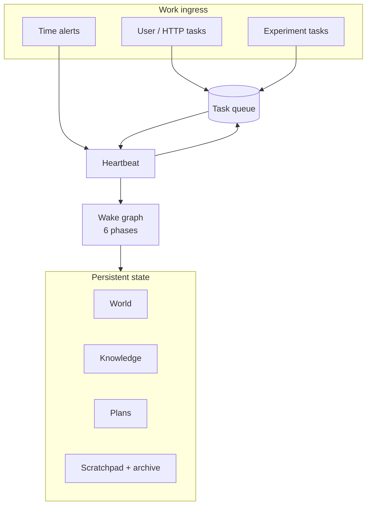

<p align="center">
  
</p>

# ThoughtBuddy

**UNDER CONSTRUCTION**

Thoughtbuddy is an attempt to create an agent that functions and thinks like an actual agent. When
complete, it will be able to think and behave like a person would.

My Current Definition of Normal Person Behavior: A normal person can observe his surroundings,
creates serendipitous opportunities for observations, understands causal relationships,
keeps key events and logic in memory and applies them to further an objective.

That objective is a hierarchical one stemming firstly from "to be happy". But as people are, we
have no fixed definition of happiness. Neither do we really stay true to one definition. And its
not something that simply sharpens over time either. Its a collection of assumptions like
"ice cream makes me happy" and arbitrary and sometimes contradictory preferences. And so the
definition of happiness evolves with experience over time.

I dont know if I will ever be able to fully model the complexities of the human condition but i hope
to model it sufficiently to see what happens when an agent embodies all of these characteristics.

Currently this repo exists as a series of experiments to test and evolve the harness that would 
provide the agent with the ability to observe and think. Starting with Chess and later on a live 
trading experiment. Building off of those we will progress to incrementally harder tasks.

Implementation detail, architecture, and roadmap: [AGENTS.md](AGENTS.md).

---

## Current state

The repo today is a **stateful agent harness**: queue-driven wakes, a fixed
**orient → observe → measure → reason → plan → act/rest** cycle, and persistent
**world**, **knowledge**, and **plans** plus scratchpad and message archive. First
experiment: chess vs Stockfish.

| Area | Summary |
|------|---------|
| **Wake harness** | Six-phase LangGraph pipeline; one ReAct subgraph per phase with phase-scoped tools |
| **Scheduling** | Heartbeat, task queue, user messages, alerts, experiment tasks, optional event webhooks |
| **State** | SQLite (tasks, plans, world, chess), Chroma knowledge, scratchpad markdown under `.data/scratchpad/` |
| **Context** | Assembled wake prompt (goals, pillars, progress, scratchpad, compaction checkpoint, transcript) |
| **Compaction** | Always on; summarizes older archive via owner `_compact.md` when context exceeds budget |
| **Budget guard** | Token count before every LLM call; archive compaction + fail-fast before vLLM context errors |
| **Chess experiment** | Agent tools + browser UI; Stockfish opponent; `./run.sh config/experiments/chess.yaml` |
| **Observability** | Optional self-hosted Langfuse; structured logging |

---

## Quick start

**Requirements:** Python 3.13+, [uv](https://docs.astral.sh/uv/), a GPU machine for local inference (or point `config.yaml` at a remote OpenAI-compatible API).

```bash
uv sync
cp .env-template .env
# Fill LANGSEARCH_API_KEY (websearch), OPENAI_API_KEY=EMPTY for local vLLM

# One-time: Stockfish when chess is active
./scripts/install_stockfish

# Optional smoke checks before experiments
./scripts/verify_vllm      # after vLLM is up
./scripts/verify_langfuse  # when Langfuse enabled in config.yaml
```

### Run the chess experiment stack

Experiment configs live under `config/experiments/` (templates in `config/experiments-template/`).

```bash
cp config/experiments-template/chess.yaml config/experiments/chess.yaml
./run.sh config/experiments/chess.yaml start
./run.sh config/experiments/chess.yaml status
```

This applies the experiment YAML to `config.yaml`, starts **vLLM**, **ThoughtBuddy** (`langgraph dev`), and **Langfuse** when enabled. Logs and PIDs go under `.data/experiments/<name>/`.

Enqueue work for the agent:

```bash
curl -X POST "http://127.0.0.1:2024/thoughtbuddy/tasks/user" \
  -H 'Content-Type: application/json' \
  -d '{"message":"Play chess vs Stockfish. Check status and make your move."}'
```

Open the chess UI (confirm port from `run.sh status` or LangGraph output):

`http://127.0.0.1:2024/thoughtbuddy/chess/ui`

Stop the stack:

```bash
./run.sh config/experiments/chess.yaml stop
```

### Manual dev (without `run.sh`)

Typical three-process session:

```bash
./scripts/start_vllm_agent.sh          # terminal 1 — OpenAI API on :8000
./scripts/start_langfuse --detach      # terminal 2 — optional
uv run langgraph dev --no-browser --allow-blocking   # terminal 3
```

Use **Qwen3 + hermes tool parser** (default profile) for reliable tool calls; see [docs/HARNESS.md](docs/HARNESS.md#llm-profiles).

---

## Configuration

| File | Purpose |
|------|---------|
| [`config.yaml`](config.yaml) | Non-secret knobs: LLM, context, runtime, experiment, observability |
| [`.env`](.env-template) | Secrets: API keys, Langfuse, webhook secret |
| [`.data/scratchpad/_goals.md`](.data-template/scratchpad/) | Owner-defined central goal (immutable to the agent) |
| `.data/scratchpad/_compact.md` | **Required** compaction prompt for the archive summarizer |
| `PROGRESS.md` / `SCRATCHPAD.md` | Agent-maintained progress summary and working state |

Context budget (defaults in `config.yaml`):

- **Hard prompt cap:** `llm.context_window_tokens - llm.max_tokens`
- **Compaction trigger:** `context.compact_token_threshold`, or `context.compact_token_ratio × max_prompt` (default **90%**) when threshold is 0

Full config reference: [docs/CONFIG.md](docs/CONFIG.md).

---

## Architecture (high level)



Wake cycle detail, entry points, and tool policy per phase: [docs/HARNESS.md](docs/HARNESS.md).

Source layout and module indexes: [src/INDEX.md](src/INDEX.md), [AGENTS.md](AGENTS.md#source-layout).

---

## Tests

```bash
uv run pytest
uv run pytest -m integration   # live LangSearch; needs LANGSEARCH_API_KEY
```

Core domains have matching test modules under `tests/` (`test_scheduling.py`, `test_context.py`, `test_harness.py`, `test_chess_experiment.py`, etc.).

---

## Documentation

| Doc | Contents |
|-----|----------|
| [AGENTS.md](AGENTS.md) | Master plan, decisions, progress tracker |
| [docs/HARNESS.md](docs/HARNESS.md) | Wake pipeline, phases, entry points, LLM profiles |
| [docs/CONFIG.md](docs/CONFIG.md) | Settings load model and YAML/env audit |
| [config/INDEX.md](config/INDEX.md) | Experiment config layout |

---

## License / status

Early research software (**0.1.0**). APIs and layout will change as the harness and experiments evolve.
