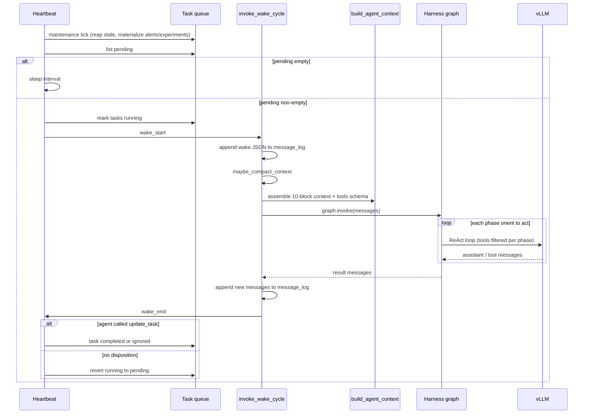
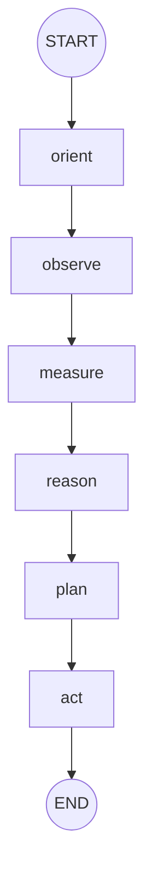
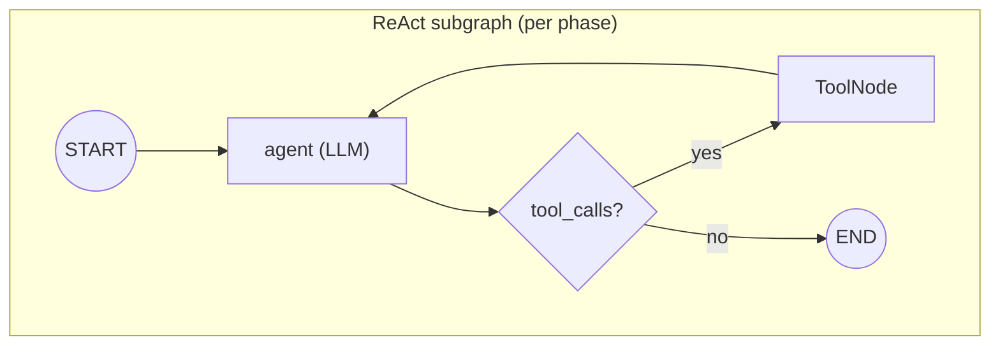
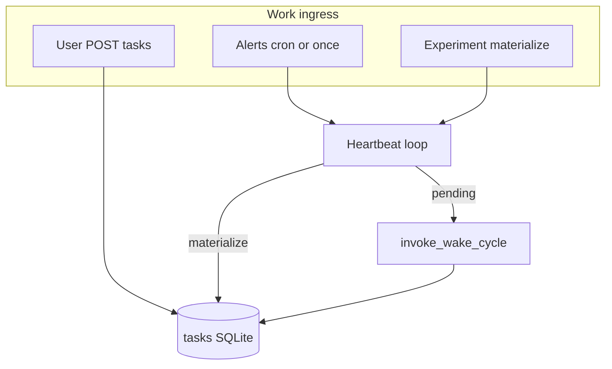

# ThoughtBuddy harness

Reference for the **wake-cycle harness**: entry points, one full interaction round, and the LangGraph node graph (phases, tools, control flow).

Master plan context lives in [AGENTS.md](../AGENTS.md). Implementation: `src/graph/`, `src/runtime/wake.py`, `src/scheduling/heartbeat.py`.

---

## LLM profiles

Switch ThoughtBuddy + vLLM together:

```bash
./scripts/set_llm_profile.sh qwen3   # or lfm
VLLM_PROFILE=qwen3 ./scripts/start_vllm_agent.sh
./scripts/verify_vllm
```

| Profile | Model | vLLM parser | Context | Notes |
|---|---|---|---|---|
| **qwen3** (default) | `Qwen/Qwen3-8B-AWQ` | `hermes` + AWQ | 32K | `enable_thinking: false` for reliable tools |
| **lfm** | `LiquidAI/LFM2.5-8B-A1B` | `lfm2` + `qwen3` reasoning | 128K | Always-on CoT; BF16 (~8B MoE in VRAM) |

Verify after start: `./scripts/verify_vllm`

---

## Entry points

How work reaches the harness. Only **queue-driven wakes** run the full six-phase graph in production; Studio is debug-only.

| Entry | Command / route | Heartbeat? | Notes |
|---|---|---|---|
| **Primary dev** | `uv run langgraph dev --no-browser --allow-blocking` | Yes | Starts Starlette lifespan → `create_runtime()` → heartbeat loop |
| **User task HTTP** | `POST /thoughtbuddy/tasks/user` | Yes (+ notify) | Body: `{"message":"...", "payload": {...}}` |
| **Event task HTTP** | `POST /thoughtbuddy/tasks/event` | Yes (+ notify) | Header `X-ThoughtBuddy-Event-Secret`; body: `message`, `event_key`, optional `payload` |
| **Monitor completion** | `run_monitored_command` → event task | Yes (+ notify) | Logs under `.data/scratchpad/monitors/<id>/`; world observation on finish |
| **Time alerts** | Agent `create_alert` → heartbeat materializes | Yes | Cron/once → `tasks` row |
| **Experiment tasks** | Heartbeat `materialize_experiment_tasks` | Yes | e.g. chess `chess_start` / `chess_continue` |
| **Ops** | `GET /thoughtbuddy/health`, `GET /thoughtbuddy/queue` | — | Queue counts, no agent invoke |
| **LangGraph Studio** | LangGraph dev UI → graph invoke | No | Bypasses task queue; debug only |
| **Direct API** | `run_agent()` in `src/agent.py` | No | Single-turn helper; not the wake pipeline |

**Process wiring:** `langgraph.json` mounts `src/webapp.py` as `http.app`. Lifespan calls `runtime.service.create_runtime()`, which builds the wake graph via `agent.create_agent()` → `graph.builder.build_graph()`.

---

## One wake round (end to end)

A **wake** is one agent invocation from pending task(s) through all six harness phases until the graph returns. Then the agent **sleeps** until the queue has pending work again.



### Steps (numbered)

1. **Ingress** — User HTTP POST, fired alert, or experiment materializer enqueues a `pending` task in SQLite.
2. **Heartbeat tick** — `HeartbeatService.tick_once()`: reap stale `running` tasks, materialize due alerts and experiment tasks (e.g. chess).
3. **Wake gate** — If `_agent_busy` or no `pending` tasks → skip LLM.
4. **Mark running** — Pending tasks for this wake become `running`.
5. **Pre-graph** (`invoke_wake_cycle`):
   - Log `wake_start`
   - Append wake instruction message (JSON: pending tasks, schedule snapshot, phase list)
   - Optional conversation compaction (`maybe_compact_context`)
   - Build full context (`build_agent_context`: system prompt, goals, plan/world/knowledge snapshots, progress, scratchpad, compaction checkpoint, transcript tail, open tasks)
6. **Harness graph** — Six phase nodes, fixed order (see below). Each phase runs a **ReAct subgraph** with phase-filtered tools.
7. **Post-graph** — Append new messages to `message_log`; log `wake_end`.
8. **Task disposition** — Agent should call `update_task` in **Act**. If still `running`, heartbeat reverts to `pending` (queue stays unblocked).
9. **Sleep** — Heartbeat waits `heartbeat_interval_seconds` (default 1s in chess dev config) and repeats.

**Rest** is a valid **Act** outcome: the phase completes with no further tool calls. It is not a skip of earlier phases.

---

## LangGraph graph (harness DAG)

Top-level compiled graph: `build_graph()` in `src/graph/builder.py`. State: `GraphState.messages` (append-only message list).



| Node | Type | Tools (filtered) | Phase instruction |
|---|---|---|---|
| `orient` | ReAct subgraph | `list_alerts` | Confirm wake reason, tasks, schedule |
| `observe` | ReAct subgraph | `websearch`, `webfetch`, `world_observe`, `world_*` | Gather external/virtual observations |
| `measure` | ReAct subgraph | `plan_read`, `world_observe`, `history_read`, `history_search` | Read world + plan readiness; no action |
| `reason` | ReAct subgraph | `knowledge_*`, `history_*` | Search/update knowledge |
| `plan` | ReAct subgraph | `plan_*` | Update plan DAG |
| `act` | ReAct subgraph | **all** registered tools | Execute, `update_task`, scratchpad/progress, rest |

Phase tool policy: `src/graph/phases.py` → `PHASE_TOOL_MATCHERS`.

---

## ReAct subgraph (inside each phase node)

Each phase node wraps LangGraph `create_react_agent(model, phase_tools)`. One **phase instruction** (`HumanMessage`) is appended before invoke. The subgraph is the standard tool-calling loop:



- **agent** — Calls vLLM with `tool_choice: auto` and phase-filtered tool schemas.
- **route** — Model returned tool calls → execute tools; else end phase.
- **tools** — Runs tool implementations (SQLite, Chroma, chess service, etc.); results return as `ToolMessage`s.

There is **no** conditional skip between harness phases — only within-phase ReAct loops.

---

## Scheduling + experiment overlay

Infrastructure graph (same process as LangGraph dev):



**Chess experiment** (`experiment.active: chess`): `materialize_chess_tasks` enqueues `chess_start` when no active agent session, or `chess_continue` when the agent is on move — deduped against inflight tasks.

---

## Context assembly (pre-graph)

Not separate graph nodes; runs once per wake before `graph.invoke`. Order (`src/context/build.py`):

1. System prompt  
2. Central goal (`_goals.md`)  
3. Plan summary  
4. World snapshot  
5. Knowledge recall  
6. Progress (`PROGRESS.md`)  
7. Scratchpad (`SCRATCHPAD.md`)  
8. Memory checkpoint (compaction summary)  
9. Verbatim transcript (post-boundary)  
10. Open tasks JSON  

---

## Related files

| Path | Role |
|---|---|
| `src/graph/builder.py` | Wake-cycle graph builder |
| `src/graph/phases.py` | Phase order, instructions, tool filters |
| `src/runtime/wake.py` | Wake context, `invoke_wake_cycle` |
| `src/scheduling/heartbeat.py` | Poll, materialize, wake, task revert |
| `src/agent.py` | `create_agent()`, Studio export |
| `src/webapp.py` | HTTP lifespan + ops routes |
| `tests/test_graph.py` | Phase order, tool filters, graph invoke |
