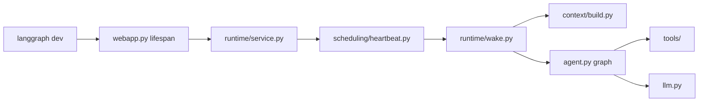

# `src/` — application root

Flat Python layout (no `thoughtbuddy/` package subfolder). Entry points for LangGraph, runtime, and configuration.

## Files

| File | Role | AGENTS.md |
|---|---|---|
| [`agent.py`](agent.py) | `create_agent()`, `make_graph()` (LangGraph export), `run_agent()` one-shot helper | [LangGraph first](#4-langgraph-first), [Process startup](#process-startup-target) |
| [`config.py`](config.py) | `Settings` model + `Settings.load()` from `config.yaml` + `.env` secrets | [Secrets and configuration](#5-secrets-and-configuration), [Configuration](#configuration) |
| [`llm/`](llm/) | `create_chat_model()`, model profile, HF/vLLM token counting | [Current implementation](#current-implementation-scaffolding) |
| [`webapp.py`](webapp.py) | Starlette app: lifespan → `create_runtime()`, ops HTTP routes | [Process startup](#process-startup-target) |
| [`__init__.py`](__init__.py) | Package marker (minimal) | — |

## Subfolders

| Folder | Purpose | Index |
|---|---|---|
| [`context/`](context/) | Model context assembly + compaction from `message_log` | [context/INDEX.md](context/INDEX.md) |
| [`db/`](db/) | SQLite connection, schema, migrations | [db/INDEX.md](db/INDEX.md) |
| [`graph/`](graph/) | Agent workflow graph (wake-cycle DAG) | [graph/INDEX.md](graph/INDEX.md) |
| [`history/`](history/) | Message archive read + BM25 search | [history/INDEX.md](history/INDEX.md) |
| [`world/`](world/) | World observation tools | [world/INDEX.md](world/INDEX.md) |
| [`knowledge/`](knowledge/) | Knowledge backend + agent tools | [knowledge/INDEX.md](knowledge/INDEX.md) |
| [`plans/`](plans/) | Plan DAG tools | [plans/INDEX.md](plans/INDEX.md) |
| [`memory/`](memory/) | ChromaDB vector store (internal to knowledge) | [memory/INDEX.md](memory/INDEX.md) |
| [`experiments/`](experiments/) | Virtual-world experiment plugins (chess) | [experiments/INDEX.md](experiments/INDEX.md) |
| [`utils/`](utils/) | Cross-cutting helpers (incl. anchored file edits) | [API retries](#8-api-retries-with-tenacity) |

## Data flow (high level)

## Tests

| Test file | Covers |
|---|---|
| `tests/test_agent.py` | `make_graph`, `create_agent` |
| `tests/test_config.py` | `Settings.load()` |

## Gaps / notes

Master follow-up checklist: **AGENTS.md → [Known gaps & follow-up](../AGENTS.md#known-gaps--follow-up)**.

- **`run_agent()`** is a convenience for single-turn chat; production wakes go through `runtime/wake.py`.
- **`make_graph()`** ignores LangGraph `RunnableConfig` — app settings always from `Settings.load()` (see `docs/CONFIG.md`).
