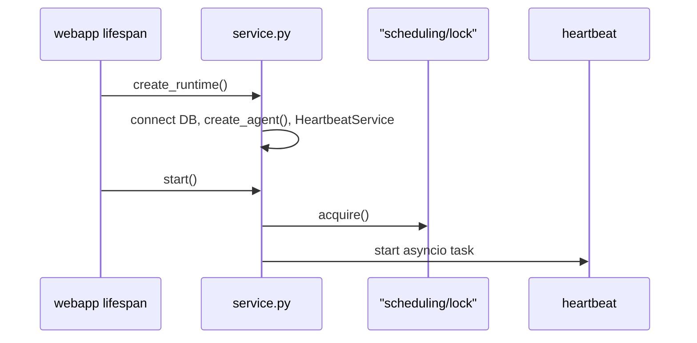

# `src/runtime/` — process orchestration & wake invoke

Bundles SQLite, PID lock, compiled graph, and heartbeat. Executes wake cycles when the task queue is non-empty.

## AGENTS.md

- [Process startup](#process-startup-target)
- [Wake cycle](#wake-cycle-target-behavior)
- [Wake rule](#scheduling-architecture-target) — queue non-empty → invoke agent
- [Concurrency](#concurrency--failure-modes-v1) — one agent run at a time (`HeartbeatService._agent_busy`)

## Files

| File | Role |
|---|---|
| [`service.py`](service.py) | `ThoughtBuddyRuntime`, `create_runtime()`, `get_active_runtime()` |
| [`monitor_service.py`](monitor_service.py) | Monitored subprocesses; completion → event task + world observation |
| [`scratchpad_layout.py`](scratchpad_layout.py) | `ensure_scratchpad_layout()` — seeds `.data/scratchpad/` from templates |
| [`wake.py`](wake.py) | `WakeContext`, `build_wake_message()`, `invoke_wake_cycle()` |

## `ThoughtBuddyRuntime` lifecycle

## Wake cycle (`wake.py`)

1. Build JSON wake payload (`build_wake_context` + `build_wake_message`) — orient data for agent
2. Append wake message to `message_log`
3. `maybe_compact_context` → `build_model_context`
4. `graph.invoke` with `RemoveMessage(REMOVE_ALL_MESSAGES)` + rebuilt context
5. Archive new messages from the turn back to `message_log`

Thread id: `settings.default_thread_id` unless overridden.

## Callers

| Caller | Usage |
|---|---|
| `webapp.py` | `create_runtime()` on lifespan startup |
| `scheduling/heartbeat.py` | `invoke_wake_cycle()` when pending tasks exist |

## Tests

| Test file | Covers |
|---|---|
| `tests/test_wake.py` | Wake message shape, invoke flow (mocked) |

## Gaps / redundancies

- **Wake steps 1–5** from AGENTS.md are not separate graph nodes — single ReAct invocation with JSON orient payload.
- **Long-term goals / scratchpad files** — not loaded in `WakeContext` yet (only tasks + upcoming alerts + queue stats).
- **`create_runtime()`** builds graph and model separately — both from same `Settings`; minor duplicate factory calls.
