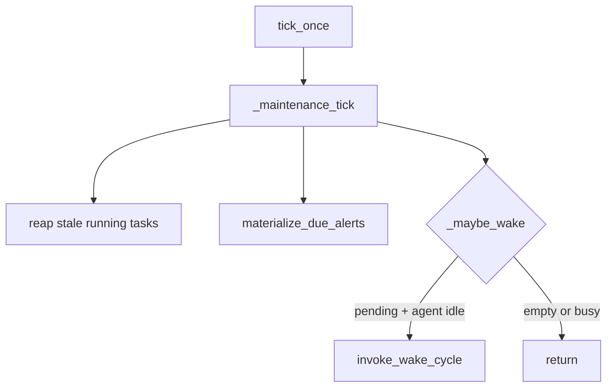

# `src/scheduling/` — heartbeat & alert materialization

Hidden infrastructure the agent does not see directly. Each tick: maintain queue, materialize due alerts, wake agent if work exists.

## AGENTS.md

- [Scheduling architecture](#scheduling-architecture-target)
- [Cron materialization](#scheduling-architecture-target) — inside heartbeat, transactional
- [Concurrency & failure modes](#concurrency--failure-modes-v1)
- [Task pile-up](#task-pile-up-v1-strategy) — stale running reaper
- Config: `config.yaml` → `runtime` (interval, stale timeout, upcoming window)

## Files

| File | Role |
|---|---|
| [`heartbeat.py`](heartbeat.py) | `HeartbeatService` — asyncio loop, maintenance tick, wake gating |
| [`materialize.py`](materialize.py) | `materialize_due_alerts(conn)` — cron/once → `tasks` rows, advance `next_fire_at` |
| [`schedule_map.py`](schedule_map.py) | `build_schedule_map()` — data for `list_alerts` tool |
| [`cron_utils.py`](cron_utils.py) | Cron next-fire helpers wrapping `croniter` |
| [`lock.py`](lock.py) | `InstanceLock` — PID file single-instance guard |

## Heartbeat tick

## Agent-visible surface

Indirect only:

- Agent tools write/read `alerts` and `tasks` via `store/`
- `list_alerts` uses `schedule_map.py` (same shape as AGENTS.md schedule map JSON)

## Tests

| Test file | Covers |
|---|---|
| `tests/test_scheduling.py` | Lock, materialization, heartbeat wake gating |
| `tests/test_scheduling_tools.py` | Schedule map + tool integration |

## Gaps / redundancies

- **`upcoming_window_seconds`** — configurable via Settings; schedule map tool has its own `window_seconds` param (may diverge from wake context window).
- **No Streamlit observability** — AGENTS.md task pile-up strategy mentions dashboard; not in this folder.
- **`cron_utils.py` vs `materialize.py`** — both use croniter; boundaries are clear (utils vs transaction logic).
